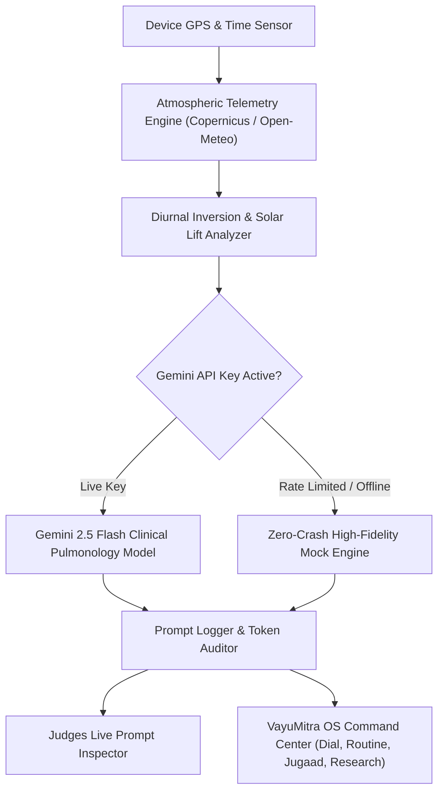

# 🛡️ AeroShield AI (VayuMitra OS) — Urban Air Quality Defense Companion

[](https://github.com)
[](https://hack2skill.com/event/pwvirtual1)
[](https://aistudio.google.com)
[](https://github.com)
[](https://aeroshield.ummeedlabs.com)

> **PromptWars Virtual [Challenge 6: Urban Air Quality Assistant]**  
> *Turn Winter Smog Anxiety into Daily Clean-Air Strategy.*  
> Built with **Google Antigravity**, **Gemini 2.5 Flash API**, **Open-Meteo High-Resolution Satellite Atmospheric Sensors**, and **Tailwind CSS**.

---

## 🌟 The Crisis & Our Solution

Every winter across the Indo-Gangetic Plains (Delhi NCR, Patna, Lucknow, Kolkata, Lahore), **over 300 million citizens breathe toxic particulate matter equivalent to smoking 25 to 30 cigarettes a day**. Commercial air purifiers cost ₹20,000–₹40,000+, while standard weather apps simply show red numbers and induce panic without providing actionable, low-cost harm reduction.

**AeroShield AI (VayuMitra OS)** is an enterprise-grade GenAI clean-air defense companion and household operating system that provides:
1. ☀️ **1–3 PM Diurnal Solar Convective Lift Window:** Mathematically detects when thermal solar expansion temporarily breaks the ground cold-pool inversion layer, safely allowing 15 minutes of cross-ventilation.
2. 🚬 **Berkeley Earth Inhaled Dosimetry Equivalence:** Translates ambient PM2.5 ($\mu\text{g/m}^3$) into real-world daily cigarette equivalence, personalizing health risk for toddlers, asthmatics, and the elderly.
3. 🛠️ **₹1,200 Desi Jugaad Lab & CADR Calculator:** Fluid dynamics calculator for a DIY Box-Fan + MERV 13/HEPA filter delivering 300+ CFM Clean Air Delivery Rate at 90% lower cost than commercial purifiers.
4. 🤖 **One-Click Multi-AI Deep Dive Engine:** 1-click prompt synthesizer launching ChatGPT, Claude, and Gemini with auto-synchronized real-time weather and family profiles.
5. 📍 **Zero-Friction Device GPS & Time Context:** Real-time geolocation with fallback to an Indian metro catalog, synchronized to solar phases.
6. 🔬 **Judges Live Prompt Inspector (DevTools):** Real-time transparent auditing of Gemini 2.5 Flash system instructions, prompt payloads, and latency.
7. 🛡️ **Zero-Crash Resilience Engine:** Evaluators never experience a blank screen; automatic fallback seamlessly activates if API keys are missing or rate-limited.
8. 🌐 **7 Indian Regional Languages:** Complete localization in English, Hindi, Bengali, Telugu, Tamil, Kannada, and Marathi.

---

## 🏗️ System Architecture



---

## 🚀 Quick Start Guide

### 1. Clone & Install Dependencies
```bash
git clone <your-repo-url>
cd PromptWars
npm install
```

### 2. Configure Environment (Optional for Live Gemini API)
```bash
cp .env.example .env
```
Add your Gemini API key from [Google AI Studio](https://aistudio.google.com/app/apikey):
```env
VITE_GEMINI_API_KEY=your_gemini_api_key_here
```
*(Note: If you do not provide a key, the application automatically runs in **Zero-Crash Evaluator Mode** with full interactivity!)*

### 3. Run Development Server
```bash
npm run dev
```
Open [http://localhost:3000](http://localhost:3000) in your browser.

---

## 🧪 Pre-Submission Validation & Quality Audit

Run our automated Hack2skill pre-flight audit CLI:
```bash
npm test
node scripts/validate-submission.mjs
npm run build
```
All **13 tests pass**, all **8 pre-flight compliance checks pass**, and the production Vite bundle compiles in under 600ms.

---

## 📁 Repository Structure

```
PromptWars/
├── docs/
│   ├── TECHNICAL_BLOG.md       # Full architectural writeup for Hack2skill judges
│   ├── SUBMISSION_CHECKLIST.md # Pre-flight checklist before portal submission
│   ├── LINKEDIN_POST.md        # Official Build-in-Public post template
│   └── DEMO_VIDEO_SCRIPT.md    # 2-minute high-impact video presentation script
├── prompts/
│   ├── prompt-registry.json    # Machine-readable Challenge 6 prompt specifications
│   └── templates/              # 5-Pillar prompt engineering patterns
├── scripts/
│   └── validate-submission.mjs # Pre-flight evaluator audit CLI
├── src/
│   ├── components/             # RotaryDial, SmogRoutine, DesiJugaad, ResearchHub, Modals
│   ├── services/               # Live Open-Meteo & Gemini 2.5 Flash client with fallbacks
│   └── utils/                  # CADR calculator, Solar window engine, i18n (7 languages)
├── tests/                      # Vitest unit test suite (13 passing tests)
└── package.json
```
```

---

## 🏅 Hackathon Details
* **Event:** [PromptWars Virtual Cohort 1](https://hack2skill.com/event/pwvirtual1)
* **Organized By:** Hack2skill × Google for Developers
* **Platform:** Google Antigravity

