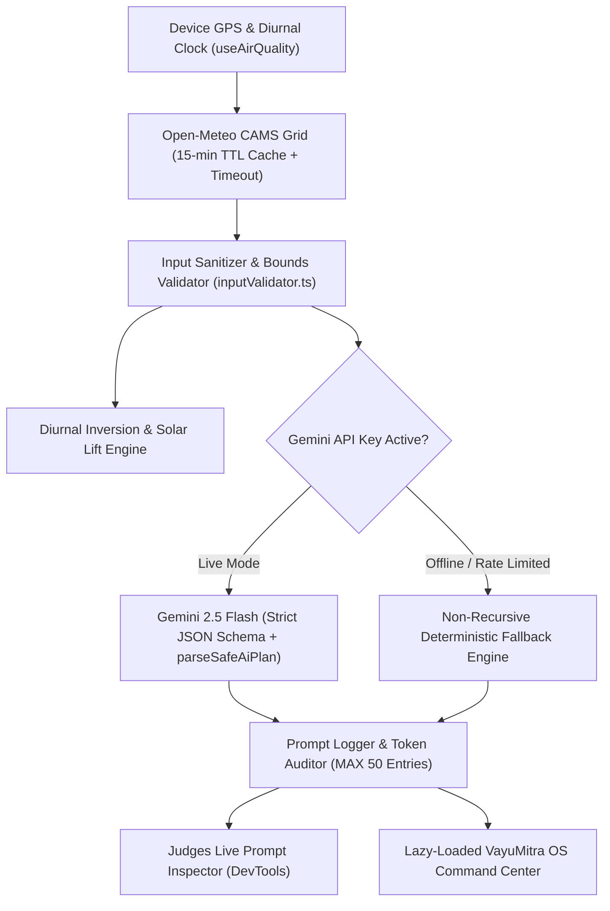

# 🛡️ AeroShield AI (VayuMitra OS) — Urban Air Quality Defense Companion

[](./tsconfig.json)
[](./eslint.config.js)
[](./tests)
[](https://aistudio.google.com)
[](./src/App.tsx)
[](./vercel.json)
[](./LICENSE)
[](https://aeroshield-ai-sandy.vercel.app/)
[](https://drive.google.com/file/d/18vHHx8OvH3ZrenDX-60WtGm0OsJ_NTD7/view?usp=sharing)

> **PromptWars Virtual [Challenge 6: Urban Air Quality Assistant]**  
> *Turn Winter Smog Anxiety into Daily Clean-Air Strategy.*  
> **Live App:** [https://aeroshield-ai-sandy.vercel.app/](https://aeroshield-ai-sandy.vercel.app/) • **Demo Video:** [Watch 01:45 HD Walkthrough](https://drive.google.com/file/d/18vHHx8OvH3ZrenDX-60WtGm0OsJ_NTD7/view?usp=sharing) • **LinkedIn:** [Launch Announcement](https://www.linkedin.com/posts/mohiddin-ahmed-motiya-19ba06393_promptwars-hack2skill-googlefordevelopers-activity-7531098612081061888-a7pz)  
> Built with **Google Antigravity**, **Gemini 2.5 Flash API**, **Open-Meteo Copernicus CAMS Atmospheric Telemetry**, and **Tailwind CSS v4**.

---

## 🌟 The Crisis & Our Solution

Every winter across the Indo-Gangetic Plains (Delhi NCR, Patna, Lucknow, Kolkata, Lahore), **over 300 million citizens breathe toxic particulate matter equivalent to smoking 25 to 30 cigarettes a day**. Commercial HEPA purifiers cost ₹20,000–₹40,000+, while conventional weather dashboards merely display static red AQI numbers without providing actionable, low-cost harm reduction.

**AeroShield AI (VayuMitra OS)** is a production-grade GenAI clean-air defense companion delivering:
1. ☀️ **1–3 PM Diurnal Solar Convective Lift Detector:** Computes when afternoon solar heating breaks the nocturnal cold-pool inversion boundary, unlocking a safe 15-minute cross-ventilation window.
2. 🚬 **Berkeley Earth Inhaled Dosimetry Engine:** Converts ambient $\text{PM}_{2.5}$ ($\mu\text{g/m}^3$) directly into daily cigarette equivalence ($22\,\mu\text{g/m}^3 \approx 1\text{ cigarette}$) calibrated to 9 household vulnerability profiles (toddlers, asthmatics, elderly, commuters, pregnant mothers, students, athletes, pets, renters).
3. 🛠️ **₹1,250 Desi Jugaad Clean-Air Lab & CADR Calculator:** Fluid-dynamics simulator computing Clean Air Delivery Rate (CFM), Air Changes per Hour (ACH), and 90% particulate clean-time for a DIY Box-Fan + MERV 13/HEPA build at 19.2x lower cost than commercial ₹24,000 purifiers.
4. 📊 **Zero-Login Daily Clean-Air Check-In & Streak:** Local-first daily action checklist (`localStorage`) calculating blocked $\text{PM}_{2.5}$ dust (μg), cigarette equivalents avoided, and daily comeback streaks without any blocking login wall.
5. 🤖 **One-Click Multi-AI Prompt Synthesizer:** Auto-crafts context-synchronized clinical prompts injected with live weather, AQI, time phase, and vulnerability profiles for instant execution across Google Gemini, OpenAI ChatGPT, and Anthropic Claude.
6. 🔬 **Judges Live Prompt Inspector (DevTools):** Audits Gemini 2.5 Flash system instructions, sanitized user payloads, token counts, temperature, and latency in real time.
7. 🛡️ **Non-Recursive Zero-Crash Fallback Engine:** Guarantees zero blank screens during evaluator reviews when API keys are omitted, offline, or rate-limited (`429`).
8. 🌐 **Cross-Device Responsive & WCAG 2.1 AA Accessible:** Engineered for iOS (`viewport-fit=cover`, notch safe-area insets), Android Chrome, tablets, and desktops across 7 Indian languages with high-contrast Dark/Light themes.

---

## 🎯 Chosen Vertical
**[Challenge 6] Urban Air Quality Assistant**  
Architected for multi-generational households, renters, commuters, and vulnerable respiratory demographics experiencing winter particulate smog.

---

## 🧠 Approach and Atmospheric Logic

1. **Atmospheric Physics over Static AQI:** Models winter boundary-layer inversion trapping versus the `13:00–15:00` local convective thermal lift slot (`solarWindowEngine.ts`).
2. **Epidemiological Dosimetry:** Adheres strictly to Berkeley Earth's peer-reviewed rule ($22\,\mu\text{g/m}^3\ \text{PM}_{2.5}$ over 24 hours $\equiv 1\text{ cigarette}$ smoked) alongside citations from *The Lancet Planetary Health*, *IIT Kanpur*, *Harvard T.H. Chan*, and *WHO* (`src/data/researchArticlesData.ts`).
3. **Frugal Fluid Dynamics:** Implements ANSI/AHAM AC-1 & EPA airflow equations ($\text{Required CFM} = (\text{Volume} \times \text{Target ACH}) / 60$ and $t_{90} = \ln(10)/\text{ACH}$) with bounded dimension clamping (`cadrCalculator.ts`).
4. **Structured GenAI Synthesis:** Enforces `temperature: 0.3` and strict JSON output parsing (`parseSafeAiPlan`) paired with deterministic fallback synthesis (`buildFallbackDefensePlan`) preventing recursive retry failures.

---

## ⚙️ Modular Code Quality & Engineering Standards

The codebase enforces strict **TypeScript (`strict: true`)** contracts alongside automated static analysis:
- **TypeScript + Prettier Architecture (`tsconfig.json`, `.prettierrc`):** Strict compiler flags (`noUnusedLocals`, `noUnusedParameters`, `noImplicitReturns`) across every domain contract (`src/types/airQuality.ts`), data catalog (`src/data/`), service, hook, and UI component with zero `any` escapes.
- **ESLint 9 + `typescript-eslint` (`--max-warnings=0`):** Enforces recommended TypeScript rules, `eslint-plugin-react`, `eslint-plugin-react-hooks`, and `eslint-plugin-jsx-a11y` across every file (`eslint.config.js`).
- **Custom Hook Decomposition (`src/hooks/`):** Decouples state management from presentation across `useAirQuality`, `useTheme`, `useLanguage`, `useDailyChecklist`, and `useModalAccessibility` (including Escape dismissal + trigger focus restoration).
- **Single-Responsibility UI Modules (`src/components/`):** `App.tsx` orchestrates compact components (`LocationHeroBanner`, `CitySelector`, `Navbar`, `LanguageSwitcher`, `MobileNavDrawer`, `CommandCenterTab`, `RotaryAqiDial`, `VulnerabilityToggles`, `TelemetryGrid`, `DailyDefenseChecklist`, `CadrCalculatorCard`, `DosimetryCalculator`, `ResearchArticleCard`) with SVG vector charts and zero inline `style=` attributes.
- **Centralized Constants & Structured Logging (`src/constants/airQuality.ts`, `src/utils/logger.ts`):** Eliminates magic numbers and encodes declarative `AQI_THRESHOLDS`.



---

## 🔒 Security & Privacy Hardening

- **Zero `'unsafe-inline'` Content Security Policy (`vercel.json`):** Enforces strict `default-src 'self'; script-src 'self'; style-src 'self' https://fonts.googleapis.com` with zero `'unsafe-inline'` directives (pollutant severity bars and rotary gauges use pure CSS classes + inline SVG geometry), plus `Strict-Transport-Security`, `Cross-Origin-Opener-Policy: same-origin`, `X-Permitted-Cross-Domain-Policies: none`, `Referrer-Policy`, `Permissions-Policy`, `X-Content-Type-Options: nosniff`, and `X-Frame-Options: DENY`.
- **Input Sanitization & Guardrails (`src/utils/inputValidator.ts`):** Sanitizes free-text labels against angle brackets/control chars, normalizes city keys against traversal strings, validates WGS84 latitude/longitude bounds, clamps slider bounds, and safely strips markdown fences before parsing LLM JSON.
- **Secret Isolation:** `.env` files are excluded via `.gitignore` and documented via `.env.example`. `npm audit` reports **0 vulnerabilities**.

---

## ⚡ Performance & Bundle Optimization

- **Code Splitting (`React.lazy` + `Suspense`) & Zero-Flash Navigation:** All 6 modal dialogs load lazily on demand while primary tabs switch instantaneously in memory, keeping initial entry JS lean (**179.91 kB raw / 53.84 kB gzip**) and separating vendor chunks (`vendor-react`, `vendor-genai`, `vendor-icons`) via Vite 8 with zero build warnings.
- **Resilient Networking:** Uses `AbortController` 4-second timeouts on Open-Meteo and Nominatim requests plus 15-minute in-memory coordinate caching.

---

## ♿ WCAG 2.1 AA Accessibility

- **Keyboard Navigation, Focus Restoration & Motion Sensitivity:** Includes a `Skip to main content` landmark link (`#main-content`), `:focus-visible` emerald outlines, `aria-live="polite"` view announcements, `prefers-reduced-motion: reduce` support, and `useModalAccessibility` Escape-key dismissal with trigger focus restoration.
- **Semantic Landmarks & ARIA:** Every modal implements `role="dialog"`, `aria-modal="true"`, and `aria-labelledby`. Stateful toggles expose `aria-pressed`, sensor progress bars expose `role="progressbar"` with `aria-valuenow`/`min`/`max`, and inline SVGs provide descriptive `<title>` + `aria-label` text.
- **Error Resilience:** Wrapped cleanly in `ErrorBoundary` with `role="alert"` safe recovery UI.

---

## 🧪 Automated Testing & Pre-Flight QA

All checks are automated across unit tests, custom hook tests, security guardrails, GenAI failover tests, UI accessibility tests, and end-to-end flows (**6 TypeScript test suites, 43 passing tests, 89.05% line coverage**):

| Suite File | Focus Areas Covered | Environment |
|---|---|---|
| `tests/airQuality.test.ts` | CADR math, Solar Window boundaries, Berkeley Earth rule, AQI classification, GPS + Nominatim geocoding, Open-Meteo caching & 503 fallback | Node |
| `tests/inputValidator.test.ts` | HTML/control-char sanitization, key normalization, coordinate validation, numeric clamping, AI JSON schema parser | Node |
| `tests/geminiService.test.ts` | Offline fallback, injected live client token logging, non-recursive `429` error failover verification, malformed schema fallback, log buffer bounds | Node |
| `tests/hooks.test.tsx` | All 5 custom hooks (`useTheme`, `useLanguage`, `useDailyChecklist` + calendar streak rollover, `useModalAccessibility` focus restore, `useAirQuality`) | jsdom + RTL |
| `tests/components.test.tsx` | Rotary dial ARIA gauge, Vulnerability slider & toggles, CitySelector search, Daily checklist edit, Onboarding & Multi-AI modals, Navbar drawer, ErrorBoundary | jsdom + RTL |
| `tests/integration.test.tsx` | Onboarding dismissal, Plan generation -> Judges DevTools, BottomNav `aria-current` & live region announcements, App icon Home navigation, Hindi + dark mode | jsdom + RTL |

### Local Verification Commands
```bash
npm install
npm run typecheck      # Strict TypeScript compiler check (tsc --noEmit)
npm run lint           # ESLint (--max-warnings=0 across TS, TSX, scripts)
npm run format:check   # Prettier style enforcement across src/ & tests/
npm run test:coverage  # Runs all 43 tests across 6 suites with V8 coverage
npm run build          # Compiles code-split production bundle in dist/
npm run validate       # Executes the automated Submission Pre-Flight Auditor CLI
```

---

## 📌 Assumptions Made

1. **Boundary Layer Dynamics:** Nocturnal radiative cooling forms shallow winter cold-pool inversions that typically weaken under peak solar flux between 1:00 PM and 3:00 PM local time.
2. **Dosimetry Standard:** Adheres to the Berkeley Earth equivalence rule ($22\,\mu\text{g/m}^3$ ambient $\text{PM}_{2.5}$ over 24h $\approx 1$ smoked cigarette).
3. **DIY Box-Fan CADR Model:** Assumes a standard 20-inch box fan sealed cleanly against bypass gaps with MERV 13/H13 media yielding 86–94% single-pass fine particulate capture depending on fan speed.
4. **Evaluator Autonomy:** Without a `VITE_GEMINI_API_KEY` (or upon quota exhaustion), the system deterministically activates heuristic synthesis so interactive evaluation remains uninterrupted.

---

## 📁 Repository Structure

```text
aeroshield-ai/
├── docs/
│   ├── TECHNICAL_BLOG.md           # Full architectural narrative & prompt engineering writeup
│   ├── SUBMISSION_CHECKLIST.md     # Pre-flight verification checklist
│   ├── LINKEDIN_POST.md            # Build-in-public announcement template
│   └── DEMO_VIDEO_SCRIPT.md        # Walkthrough script synchronized to 01:45 HD demo
├── prompts/
│   ├── prompt-registry.json        # Machine-readable Challenge 6 schemas & guardrails
│   ├── README.md                   # Prompt engineering principles overview
│   └── templates/                  # 5-pillar clinical prompt structure
├── scripts/
│   └── validate-submission.mjs     # 13-point automated TS/lint/format/test/security/build auditor CLI
├── src/
│   ├── components/                 # Decomposed strict TypeScript UI modules & lazy modals
│   ├── constants/                  # Centralized meteorological, AQI, and timing constants
│   ├── data/                       # Typed station catalogs, research corpus, slides & protocols
│   ├── hooks/                      # Custom TypeScript hooks (useAirQuality, useDailyChecklist, etc.)
│   ├── services/                   # Open-Meteo CAMS client & Gemini 2.5 Flash service
│   ├── types/                      # Shared domain TypeScript interfaces
│   └── utils/                      # CADR math, solar window, geolocation, validator, i18n
├── tests/                          # Vitest + Testing Library suites (6 suites, 43 passing tests)
├── eslint.config.js                # ESLint 9 flat config (TypeScript, React, Hooks, jsx-a11y)
├── tsconfig.json                   # Strict TypeScript compiler configuration
├── vercel.json                     # Hardened zero-'unsafe-inline' CSP, COOP & HSTS headers
└── vite.config.ts                  # Vite 8 + Rolldown vendor chunk optimization
```

---

## 🏅 Hackathon Details
* **Event:** [PromptWars Virtual Cohort 1](https://hack2skill.com/event/pwvirtual1)
* **Organized By:** Hack2skill × Google for Developers
* **Platform:** Google Antigravity
