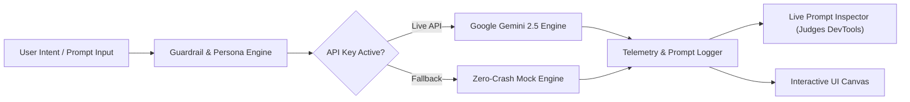

# 🚀 PromptWars Virtual — AI Intent Engine & Vibe-Coding Studio

[](https://github.com)
[](https://hack2skill.com/event/pwvirtual1)
[](https://aistudio.google.com)
[](https://github.com)

> Production-ready, intent-driven AI builder suite developed for **PromptWars Virtual** (organized by **Hack2skill** in partnership with **Google for Developers**).

---

## 🌟 Key Capabilities

* ⚡ **Intent-Driven Architecture ("Vibe Coding"):** Rapidly prototypes and generates full-stack software solutions from natural language prompts using Google Antigravity and the Gemini 2.5 API.
* 🛡️ **Zero-Crash Mock Fallback Engine:** Evaluators never encounter a broken app or blank screen. If the Gemini API key is missing or hits quota limits, the app automatically switches to high-fidelity simulated responses.
* 🔍 **Live Prompt Inspector (Judges DevTools):** An embedded in-app drawer that enables evaluators to inspect real-time system instructions, prompt payloads, temperature parameters, and token latency.
* 📋 **Automated Submission Validator CLI:** Run `npm run validate` to audit the repository against Hack2skill evaluation criteria before submitting.

---

## 🏗️ System Architecture



---

## 🚀 Quick Start Guide

### 1. Clone & Install Dependencies
```bash
git clone <your-repo-url>
cd PromptWars
npm install
```

### 2. Configure Environment (Optional for Live API)
Copy the example environment configuration:
```bash
cp .env.example .env
```
Add your Google Gemini API key from [Google AI Studio](https://aistudio.google.com/app/apikey):
```env
VITE_GEMINI_API_KEY=your_actual_gemini_api_key_here
```
*(Note: If you skip adding a key, the application will safely run in **Evaluator Mock Mode** with full interactivity!)*

### 3. Run Development Server
```bash
npm run dev
```
Open [http://localhost:3000](http://localhost:3000) in your browser.

---

## 🧪 Pre-Submission Validation Check

Before submitting your project on the Hack2skill portal, run our automated auditor:
```bash
npm run validate
```
This runs a 6-point check verifying:
1. Git repository and security `.gitignore` configuration.
2. Production build compilation without errors (`npm run build`).
3. Prompt engineering registry and schema documentation.
4. Rubric-compliant Technical Blog in `docs/TECHNICAL_BLOG.md`.
5. Pre-flight submission checklist in `docs/SUBMISSION_CHECKLIST.md`.
6. LinkedIn build-in-public template with official tags.

---

## 📁 Repository Structure

```
PromptWars/
├── docs/
│   ├── TECHNICAL_BLOG.md       # 10/10 Rubric-aligned Build-in-Public writeup
│   ├── SUBMISSION_CHECKLIST.md # Pre-flight checklist before submitting
│   ├── LINKEDIN_POST.md        # Social viral post template with official tags
│   └── DEMO_VIDEO_SCRIPT.md    # 2-minute pitch script for judges
├── prompts/
│   ├── prompt-registry.json    # Machine-readable prompt specifications
│   └── templates/              # 5-Pillar prompt engineering patterns
├── scripts/
│   └── validate-submission.mjs # Pre-flight evaluator audit CLI
├── src/
│   ├── components/             # ErrorBoundary, PromptInspector, Navbar
│   ├── services/               # Gemini API client & Zero-Crash Mock Engine
│   └── utils/                  # Real-time prompt logger
├── WINNING_PLAYBOOK.md         # Evaluator rubrics & Reddit insights guide
└── package.json
```

---

## 🏅 Hackathon Details
* **Event:** [PromptWars Virtual Cohort 1](https://hack2skill.com/event/pwvirtual1)
* **Organized By:** Hack2skill × Google for Developers
* **Platform:** Google Antigravity
