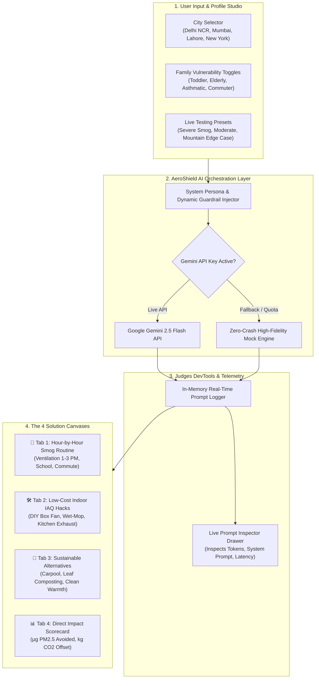

# 🌫️ AeroShield AI (VayuMitra OS): Master Knowledge Base & Design System
## Challenge 6: Urban Air Quality Assistant | Single Source of Truth & Project History

> **Competition:** PromptWars Virtual (Hack2skill × Google for Developers)  
> **Challenge Window:** 16/11/2026 – 29/11/2026  
> **Target Audience:** Families & urban communities navigating severe winter smog and urban air pollution.  
> **Evaluation Focus:** High Impact (Problem Alignment & Code Quality), Medium Impact (Security & Efficiency), Low Impact (Testing & Accessibility).

---

## 📖 Table of Contents
1. [Comprehensive Glossary of All Technical Terms](#1-comprehensive-glossary-of-all-technical-terms)
   - Atmospheric Science & Environmental Health Terms
   - GenAI & Vibe-Coding Terms
2. [Target Audience & Focus Niche](#2-target-audience--focus-niche)
   - Core Problem: The Actionability Gap
   - 4 Detailed User Personas
3. [Competitive Analysis & Top Apps in the Market](#3-competitive-analysis--top-apps-in-the-market)
   - IQAir (AirVisual), Plume Labs, BreezoMeter, and CPCB Sameer
   - What We Borrow & Our Unfair Advantage (USP)
4. [Complete Web App Blueprint & Architecture](#4-complete-web-app-blueprint--architecture)
   - End-to-End User Journey
   - The 4 Core Solution Modules
   - Zero-Crash Mock Fallback & Judges Prompt Inspector
5. [UI/UX Design System, Visuals & Animation Inspirations](#5-uiux-design-system-visuals--animation-inspirations)
   - Dynamic AQI Ambient Glow System
   - Glassmorphic Component Library
   - Micro-Interactions & Animations
6. [Submission Portal Answers & Video Demonstration Blueprint](#6-submission-portal-answers--video-demonstration-blueprint)

---

## 1. Comprehensive Glossary of All Technical Terms

To master this domain and build an authoritative application, here is every technical term explained in plain, precise terms:

### A. Environmental Health & Atmospheric Science Terms

| Term | Full Name / Unit | Plain Explanation & Why It Matters for Our App |
| :--- | :--- | :--- |
| **AQI** | Air Quality Index (Scale 0–500+) | A standardized numerical scale indicating how clean or polluted the air is. The Indian National AQI (NAQI) and US EPA AQI categorize air into 6 tiers: Good (0–50), Satisfactory/Moderate (51–100), Moderate/Unhealthy for Sensitive (101–150/200), Poor/Unhealthy (151–200), Very Poor (201–300), and Severe/Hazardous (301–500+). |
| **PM2.5** | Fine Particulate Matter ($\le 2.5\ \mu\text{m}$) | Microscopic combustion particles (from car exhausts, stubble burning, coal power) thinner than a human hair ($70\ \mu\text{m}$). **Why critical:** They bypass nasal filters, penetrate deep into the pulmonary alveoli, and enter the bloodstream, causing cardiovascular and respiratory illness. |
| **PM10** | Coarse Particulate Matter ($\le 10\ \mu\text{m}$) | Dust, pollen, and construction debris. Irritates eyes, nose, throat, and upper respiratory tract. |
| **$\mu\text{g/m}^3$** | Micrograms per cubic meter | The physical mass concentration of pollutants in air. WHO 24-hour safe guideline for PM2.5 is $15\ \mu\text{g/m}^3$. In winter Delhi/Lahore smog, levels routinely exceed $400\text{--}800\ \mu\text{g/m}^3$ (25× to 50× safe limits!). |
| **Thermal Inversion** | Temperature Inversion Layer | The primary meteorological reason winter smog is catastrophic. Normally, warm air near ground rises and disperses pollutants. In winter, cold air is trapped beneath a blanket of warm air, acting like a lid that seals vehicle exhaust and dust at breathing level. **Key Insight:** Inversion is worst at 5 AM–9 AM and late night; solar radiation breaks it slightly between **1 PM and 3 PM** (the safest ventilation window!). |
| **Photochemical Smog** | Smog = Smoke + Fog | A toxic cocktail created when sunlight triggers chemical reactions between $\text{NO}_x$ (from cars) and VOCs (volatile organic compounds), forming ground-level Ozone ($\text{O}_3$). |
| **IAQ** | Indoor Air Quality | The air quality inside homes, schools, and offices. Contrary to popular belief, indoor air is often 2× to 5× more toxic than outdoor air during winter due to trapped cooking fumes, incense/candle smoke, and dust resuspension. |
| **Resuspension of Dust** | Mechanical Disturbance | When dry sweeping with a broom kicks settled PM2.5 back into the breathing zone for 2–3 hours. **Our IAQ Hack:** Mandatory *wet-mopping* (moist microfiber mop) which traps particles without airborne resuspension. |
| **HEPA** | High-Efficiency Particulate Air | A mechanical air filter standard that traps at least $99.97\%$ of airborne particles down to $0.3\ \mu\text{m}$. |
| **MERV 13** | Minimum Efficiency Reporting Value | Rating scale (1–16) for filters. MERV 13 is the sweet spot used for DIY box-fan air purifiers because it traps fine viral and PM2.5 smog particles without choking household fan motors. |
| **CADR** | Clean Air Delivery Rate | Metric ($m^3/\text{hour}$ or $\text{CFM}$) indicating how much filtered air a purifier produces. A DIY 20-inch box-fan with MERV 13 filter produces higher CADR ($\sim 300\ \text{CFM}$) than many ₹15,000 commercial air purifiers! |
| **GRAP** | Graded Response Action Plan | India’s official emergency response framework (Stages 1 to 4) triggered when AQI crosses 201, 301, 401, and 450+. Mandates vehicle restrictions (odd-even, truck bans), school closures, and construction halts. |
| **Exposure Budget** | Accumulated Particulate Inhalation | The total estimated microgram mass of PM2.5 inhaled into lung tissue over a 24-hour cycle ($\text{Exposure} = \text{AQI concentration} \times \text{Breathing Rate} \times \text{Time Duration}$). |

---

### B. GenAI & Vibe-Coding Terms

| Term | Plain Explanation & Why It Matters for Our App |
| :--- | :--- |
| **Intent-Driven Dev / Vibe-Coding** | Shifting from manual syntax writing to directing AI agents through high-level intent, structured prompts, and automated architectural constraints. |
| **System Persona / Calibration** | Explicit instructions given to the LLM (e.g., *"You are a senior Environmental Health Epidemiologist and Urban Sustainable Architect"*). Prevents conversational filler and ensures actionable, scientifically grounded outputs. |
| **Structured Output Schema** | Forcing the model to return deterministic JSON structures (`daily_routine`, `indoor_hacks`, `impact_scorecard`) rather than freeform prose, making rendering 100% predictable. |
| **Guardrails & Negative Constraints** | Hardcoded logic and prompt rules that block dangerous hacks (e.g., forbidding unsafe ozone-generating ionizers) and detect edge cases (e.g., clean air in mountain towns). |
| **Zero-Crash Mock Fallback Engine** | Our proprietary safety layer that simulates high-fidelity structured data if the reviewer has no Gemini API key, network drops, or hits rate limits (`429`). The evaluator will never see a blank screen. |
| **In-App Prompt Inspector** | Embedded slide-over DevTools drawer allowing judges to audit system prompts, temperatures, and latencies live during evaluation. |

---

## 2. Target Audience & Focus Niche

### The Core Problem: The Actionability Gap
Existing air quality apps give users anxiety without agency. A user opens an app, sees **"AQI 425: Hazardous"**, panics, and continues their normal day because they don't know:
- *When is it safe to air out the bedroom today?*
- *Should my 3-year-old go to morning school assembly?*
- *Can I afford an air purifier on a tight budget?*
- *Does carpooling today actually make any measurable difference?*

**AeroShield AI** targets this exact gap.

### The 4 Core User Personas

```
┌─────────────────────────────────────────────────────────────────────────────┐
│ PERSONA 1: The Multigenerational Urban Household                           │
│ • Composition: Parents + Toddler (developing lungs) + Grandparent (COPD/BP)│
│ • Pain Point: Conflicting needs—grandparents need walking, child needs play │
│ • Solution: Safe solar-window outdoor play (1-3 PM) + indoor filter hacks   │
├─────────────────────────────────────────────────────────────────────────────┤
│ PERSONA 2: The Daily Two-Wheeler / Open-Air Commuter                        │
│ • Profile: Travels 20 km daily on motorcycle/scooter across city ring roads │
│ • Pain Point: Direct, unmitigated blast of vehicle exhaust and road dust   │
│ • Solution: Staggered commute departure times + N95 valve vs non-valve mask │
│   guide + alternate green-corridor routing                                  │
├─────────────────────────────────────────────────────────────────────────────┤
│ PERSONA 3: The Budget-Conscious Apartment Renter                           │
│ • Profile: Rents a 2BHK flat, cannot afford ₹25,000 commercial purifiers    │
│ • Pain Point: Drafty balcony doors, gas stove fumes, high PM2.5 inside     │
│ • Solution: ₹1,500 DIY Box-Fan HEPA purifier + wet-mop protocols + plants  │
├─────────────────────────────────────────────────────────────────────────────┤
│ PERSONA 4: The School / Community / RWA Coordinator                         │
│ • Profile: Manages residential apartment complex or school campus           │
│ • Pain Point: Open leaf-burning in winters, morning assembly smog exposure │
│ • Solution: Composting alternatives for dry leaves + indoor assembly rules  │
└─────────────────────────────────────────────────────────────────────────────┘
```

---

## 3. Competitive Analysis & Top Apps in the Market

| Feature / Dimension | IQAir (AirVisual) | Plume Labs (Flow) | BreezoMeter (Google) | Sameer (CPCB India) | **AeroShield AI (Our Solution)** |
| :--- | :---: | :---: | :---: | :---: | :---: |
| **Real-time AQI & Pollutant Breakdown** | ✅ Excellent | ✅ Good | ✅ Excellent | ✅ Raw CPCB Data | ✅ Interactive City Presets & Real Telemetry |
| **Hourly Smog Dispersion Forecast** | ✅ Multi-day | ✅ 72-hour | ✅ Dynamic | ❌ Station-bound | ✅ **Solar-Inversion Aware Hourly Routine** |
| **GenAI Intent-Driven Personalization** | ❌ None | ❌ None | ❌ None | ❌ None | 🌟 **Core Pillar: Custom Family Personas** |
| **Low-Cost DIY Indoor Air (IAQ) Hacks** | ❌ (Promotes their $900 purifiers) | ❌ None | ❌ None | ❌ None | 🌟 **Core Pillar: Budget DIY HEPA & Wet-Mop** |
| **Sustainable Community Alternatives** | ❌ None | ❌ Minimal | ❌ None | ❌ None | 🌟 **Core Pillar: Actionable Emission Shifts** |
| **Direct Impact Scorecard (μg + CO2)** | ❌ None | ⚠️ Rough index | ❌ None | ❌ None | 🌟 **Core Pillar: Quantified Health/Carbon Offset** |
| **Judges DevTools / Prompt Inspector** | ❌ None | ❌ None | ❌ None | ❌ None | 🌟 **Core Pillar: Live Telemetry for Evaluators** |

---

## 4. Complete Web App Blueprint & Architecture



---

## 5. UI/UX Design System, Visuals & Animation Inspirations

### A. Dynamic AQI Ambient Glow System
The user interface dynamically adapts its ambient glow, accent colors, and warnings based on the active city's AQI:

| AQI Range | Status Tier | Dominant Color | Ambient Backdrop Glow | User Guidance Badge |
| :---: | :---: | :---: | :---: | :---: |
| **0 – 50** | Good / Pristine | Emerald Green (`#10B981`) | Subtle Emerald Radial Glow | "Safe for all outdoor activities" |
| **51 – 100** | Moderate | Cyan / Sky Blue (`#0EA5E9`) | Soft Cyan Ambient Glow | "Sensitive groups monitor air" |
| **101 – 200** | Poor / Unhealthy | Amber Yellow (`#F59E0B`) | Warm Amber Diffused Light | "Limit prolonged outdoor exertion" |
| **201 – 300** | Very Poor | Bright Orange (`#F97316`) | Deep Orange Warning Border | "N95 mask mandatory outdoors" |
| **301 – 400** | Severe | Ruby Red (`#EF4444`) | Crimson Red Pulsing Gradient | "Avoid all non-essential outdoor trips" |
| **401 – 500+** | Hazardous / Toxic | Deep Maroon / Violet (`#881337`) | Toxic Violet Smog Radial Glow | "Emergency Smog Protocol Active" |

### B. Micro-Interactions & Animation Inspirations
1. **Breathing AQI Status Dial:** A circular SVG dial whose stroke-dashoffset smoothly animates when switching cities, accompanied by a subtle "breathing" pulse animation.
2. **Interactive Persona Toggles:** Checkbox pills that bounce slightly on click (`active:scale-95 transition-transform`) and immediately recalculate the vulnerability badge.
3. **Tab Switcher Slide Effect:** Smooth fading and sliding transition between the 4 output tabs using CSS keyframes.
4. **Animated Stat Counters:** The Direct Impact numbers (e.g. `$284\ \mu\text{g}$ PM2.5 Inhalation Avoided`) animate upward when generation completes.
5. **Glassmorphism Backdrop:** `backdrop-blur-xl bg-slate-900/70 border border-slate-800` giving a modern, premium feel reminiscent of Linear and Apple Weather.

---

## 6. Submission Portal Answers & Video Demonstration Blueprint

All portal fields have been pre-written in [`challenges/challenge-06-urban-air-quality/SUBMISSION_PORTAL_DRAFT.md`](file:///D:/PROJECTS/PromptWars/challenges/challenge-06-urban-air-quality/SUBMISSION_PORTAL_DRAFT.md):
- **Changes/Updates in Deployed Version:** Concise 6-point breakdown fitting within the 1024-character limit.
- **GenAI Services Utilized:** Explicit description of Gemini 2.5 Flash, structured JSON schemas, in-app Prompt Inspector, and zero-crash mock fallback.
- **LinkedIn Post Draft:** Formatted with official hashtags (`#BuildwithAI #PromptWarsVirtual #Challenge6`) and tags (`@hack2skill @googlefordevs`).
- **Demo Video Script:** Formatted under 4 minutes with live typing, GenAI highlights, and edge cases.
