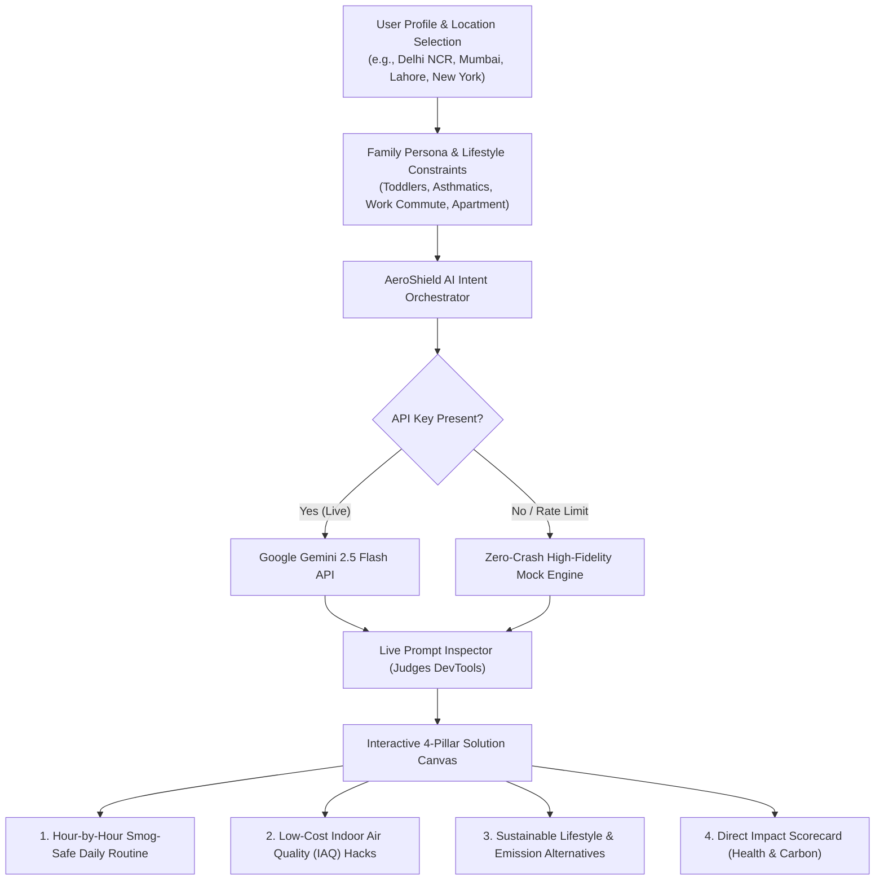

# 🌫️ Challenge 6: Urban Air Quality Assistant (AeroShield AI / VayuMitra OS)
## Master Plan, UI/UX Design System & Architectural Blueprint

> **Problem Statement:**  
> *"Create a GenAI-powered assistant that helps families and communities navigate severe winter smog and urban air pollution. The application should suggest low-emission daily routines, indoor air quality hacks, and sustainable alternatives tailored to their location and lifestyle, while clearly explaining the direct impact of their choices."*
>  
> **Challenge Window:** 16/11/2026 – 29/11/2026  
> **Evaluation Tier:** High Impact (Problem Alignment & Code Quality) | Medium Impact (Security & Efficiency) | Low Impact (Testing & Accessibility)

---

## 1. Deep Insights from SME Sabyasachi & Jitesh Kaul's Explainer Video

From the official Hack2skill YouTube session (`-T4IllyVC6o`), the key expectations from evaluators are:

1. **Root Problem Alignment (High Impact):**
   * Don't just show static AQI numbers. A user can get AQI from Google Weather.
   * The app **must bridge the gap between "Air is Bad" and "What specific actionable routine should my family follow right now?"**
   * Must account for vulnerable groups: toddlers, elderly, asthma patients, pregnant women, and daily commuters.
   * Must include **Direct Impact Explanation**—quantifying health risk reduction and household emission savings.

2. **Why the Video & Fallback are Mandatory:**
   * Evaluators test dozens of submissions. If an API key hits rate limits or expires, an app without a fallback gets an immediate penalty.
   * The video submission (<4 mins) is used to verify live testing, dynamic AI generation, and edge cases.

3. **Technical Scoring Pillars:**
   * **Code Quality:** Modern React 19 component structure, zero warnings, clean separation of concerns.
   * **Security:** No hardcoded secrets, `.env` isolated, sanitization.
   * **Efficiency:** Sub-second latency via Gemini 2.5 Flash with structured JSON schemas.
   * **Testing:** Dedicated Vitest test suites verifying routine generation and calculation consistency.
   * **Accessibility:** Semantic HTML, ARIA tags, color-blind safe AQI indicators.

---

## 2. UI/UX Design Benchmarks & Inspirations

We benchmarked the world's best environmental and air quality interfaces to synthesize our design system:

| Benchmark App | Design Element Borrowed | How We Implement It |
| :--- | :--- | :--- |
| **IQAir / AirVisual** | Dynamic AQI Severity Gauge & Color Palette | 6-tier AQI spectrum (Green `0-50`, Yellow `51-100`, Orange `101-150`, Red `151-200`, Purple `201-300`, Maroon `301-500+`). Dynamic ambient card glow that shifts based on selected city's AQI. |
| **Apple Weather AQI** | Micro-Card Health Recommendations | Instant visual badges: "N95 Mask Needed", "Keep Windows Closed", "Air Purifier Mode: High", "Avoid Outdoor Sports". |
| **BreezoMeter** | Sensitive Group Vulnerability Matrix | Interactive Family Member toggles (Infants, Elderly, Asthmatics, Athletes, Outdoor Commuters) that calibrate the advice. |
| **Plume Labs** | Exposure & Emission Impact Scorecard | Calculates estimated PM2.5 lung deposition avoided ($\mu\text{g}$) and household carbon emission offset ($\text{kg CO}_2$). |

---

## 3. Product Architecture: "AeroShield AI" (VayuMitra)

---

## 4. The 4 Core Feature Modules

### Module 1: Hour-by-Hour Smog-Safe Daily Routine
* Dynamically adapts to local thermal inversion (winter smog is worst early morning 5 AM – 9 AM and late night).
* Recommends:
  * Safe ventilation window (usually 1 PM – 3 PM when solar radiation disperses ground-level smog).
  * Safe commute windows and route alternatives.
  * Indoor school/play routines for children.

### Module 2: High-Impact Indoor Air Quality (IAQ) Hacks
* **DIY HEPA Filter Box-Fan Hack:** Step-by-step instructions for budget-conscious families.
* **Wet-Mopping vs Sweeping:** Explains how dry sweeping resuspends PM2.5 particles indoors.
* **Natural Botanical Air Cleaners:** Optimal placement of Snake Plants, Areca Palms, and Spider Plants.
* **Kitchen & Cooking Venting Protocol:** Safe cooking oils, exhaust fan timing during winter.

### Module 3: Sustainable Alternatives & Emission Reductions
* Community-level and household micro-actions to stop adding to the smog:
  * Public transit / EV / Carpooling routes.
  * Alternatives to open burning for winter warmth (thermal blankets, insulated curtains).
  * Clean heating alternatives.

### Module 4: Direct Impact Calculator
* Quantifies the consequence of user choices:
  * **Health Defense:** Estimated reduction in inhaled particulate matter ($\mu\text{g}$ PM2.5).
  * **Community Footprint:** Estimated $\text{kg CO}_2$ and particulate emissions saved by following the green commute alternative.

---

## 5. UI/UX Layout & Wireframe Specification

* **Top Navigation:**
  * AeroShield Logo + "Challenge 6 Edition" Badge
  * Live Location AQI Status Pill (e.g. `Delhi NCR - AQI 418 Hazardous 🔴`)
  * "Inspect Prompts (DevTools)" button with prompt execution counter
* **Hero Banner:**
  * High-contrast dark theme (`bg-slate-950` with subtle smog-radial gradient)
  * Dynamic AQI level gauge with live primary pollutants (PM2.5, PM10, $\text{NO}_2$)
* **Left Panel (Inputs - 5 Cols):**
  * City Selector (Delhi NCR, Mumbai, Kolkata, Lahore, New York, London, Custom)
  * Family Profile / Vulnerability Toggles (Toddler, Elderly, Asthma, Pet)
  * Daily Routine Constraints (Office Commute, School Going, Home Maker)
  * "Run Live Test Preset" buttons (Normal Day, Severe Smog Spike, Edge Case Clean Air)
  * "Execute Air Assistant" CTA
* **Right Panel (Results Canvas - 7 Cols):**
  * Tab 1: **Daily Routine** (Timeline view of morning, afternoon, evening, night)
  * Tab 2: **Indoor Hacks** (Card deck of actionable low-cost fixes with impact rating)
  * Tab 3: **Green Alternatives** (Side-by-side comparison: Standard vs Sustainable)
  * Tab 4: **Impact Metrics** (Visual stat cards: PM2.5 avoided, Health risk reduced, Carbon saved)
