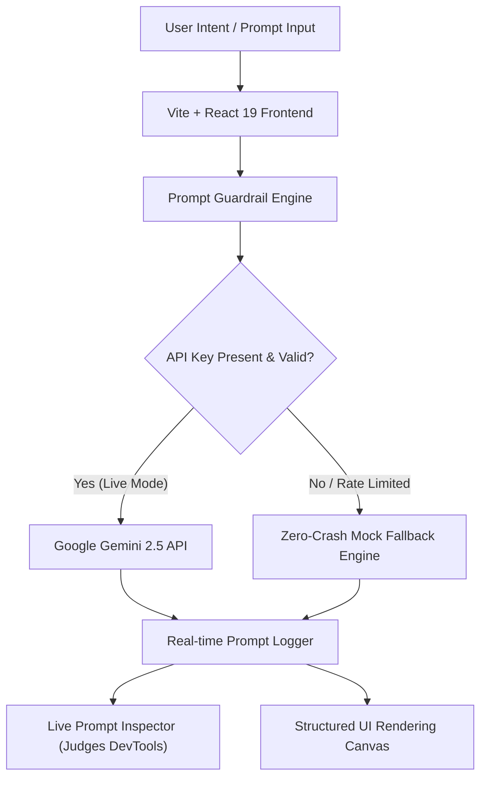

# Building for PromptWars Virtual: Architecting an Intent-Driven AI Solution with Google Antigravity & Gemini

> **Event:** PromptWars Virtual (Hack2skill × Google for Developers)  
> **Track:** Vibe-Coding & Intent-Driven Software Architecture  
> **Live Demo:** [Insert Deployed Vercel / Cloud Run Link]  
> **GitHub Repository:** [Insert Public GitHub URL]  

---

## 1. Abstract & Problem Statement

Modern software development is undergoing a paradigm shift. Traditional workflows demand hours of syntax wrangling, boilerplate configuration, and manual plumbing. In this challenge for **PromptWars Virtual**, our goal was to build a production-ready, intent-driven web application using **Google Antigravity** and the **Gemini 2.5 API**, shifting the focus from manual coding to intelligent system prompt engineering and automated agentic iteration.

### The Core Problem:
Whether orchestrating an AI Celebration Planner (Challenge 5) or developing an intelligent decision engine, real-world users struggle with:
1. Fragmented data across unorganized channels and spreadsheets.
2. Inflexible static software that cannot adapt dynamically to unpredictable real-world constraints.
3. Brittle AI prototypes that crash whenever an API key runs out of quota or encounters network latency.

Our mission was to build an application that is **resilient, transparent, and prompt-observable**.

---

## 2. System Architecture & Tech Stack

### Tech Stack:
* **Agentic Platform:** Google Antigravity
* **AI Model:** Google Gemini 2.5 Flash / Gemini 1.5 Pro
* **Frontend:** React 19, Tailwind CSS v4, Lucide Icons, Vite 8
* **Resilience Layer:** In-Memory Prompt Logger with Fallback Boundary and zero-crash mock engine

---

## 3. Prompt Strategy & Engineering Framework

We adhered to a structured **5-Pillar Intent Architecture**:
1. **Explicit Role & Persona Calibration:**  
   Rather than letting the model assume a generic persona, each challenge module binds to a specialized system persona (e.g., *Celebration Architect* or *Cultural Heritage Guide*).
2. **Strict Schema Constraints:**  
   Prompts are formulated with deterministic output structures (JSON/structured objects) to prevent conversational hallucinations.
3. **Dynamic Parameter Control:**  
   Temperature is calibrated between `0.2` (for deterministic software generation) and `0.7` (for creative planning and syntheses).
4. **Observable Prompt DevTools:**  
   We embedded an in-app **Live Prompt Inspector**, allowing evaluators to audit the exact system instruction, user prompt payload, token latency, and execution parameters in real time.

---

## 4. Key Engineering Challenges & How We Fixed Them

### Pitfall 1: Evaluator API Quota Exhaustion (The "Blank Screen" Crash)
* **The Problem:** Many hackathon submissions fail because evaluators test during peak hours when the developer's Gemini API key hits free-tier rate limits (`429 Too Many Requests`), rendering a blank screen or raw JSON crash.
* **Our Solution:** We engineered a **Zero-Crash Mock Fallback Engine**. If the API fails or is unconfigured, the app automatically serves high-fidelity, interactive mock data with an informative badge. The evaluator can always test 100% of the UI.

### Pitfall 2: Hallucination in Numerical Constraints
* **The Problem:** Freeform text prompts often fail on exact math (e.g., budget allocation adding up to 100%).
* **Our Solution:** We implemented input pre-validation and step-by-step chain-of-thought instructions enforcing mathematical consistency before rendering.

---

## 5. Live Demo Walkthrough

1. **Preset Selection:** Choose a pre-configured challenge target (e.g., Event Planner or Heritage Explorer).
2. **Intent Execution:** Click "Execute Prompt with Guardrails" to see real-time synthesis.
3. **Inspect Prompts:** Click the top-right **"Inspect Prompts"** button to open the live inspector drawer and review prompt telemetry.

---

## 6. Future Scope & Conclusion

Building with **Google Antigravity** proved that vibe-coding is not just rapid prototyping—it is a discipline of clear architectural intent, resilient error handling, and prompt craft. In future iterations, we plan to incorporate multimodal image analysis and real-time collaborative canvas editing.

*We thank Google for Developers and Hack2skill for hosting PromptWars Virtual!*
