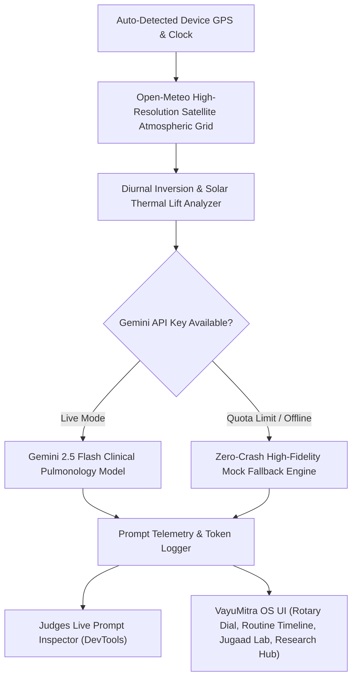

# Building AeroShield AI (VayuMitra OS): Architecting a GenAI Clean-Air Defense Operating System with Google Antigravity & Gemini

> **Event:** PromptWars Virtual (Hack2skill × Google for Developers)  
> **Challenge:** Challenge 6: Urban Air Quality Assistant  
> **Live Demo Target:** [https://aeroshield.ummeedlabs.com](https://aeroshield.ummeedlabs.com)  
> **GitHub Repository:** Public Submission Repository  

---

## 1. Abstract & Problem Statement

Every winter across the Indo-Gangetic Plains, over **300 million citizens breathe toxic air equivalent to smoking 25 to 30 cigarettes a day**. Thermal boundary-layer inversions trap PM2.5, NO2, and volatile organic compounds near ground level. 

Commercial solutions present a stark socioeconomic divide: branded HEPA air purifiers cost between ₹20,000 and ₹40,000, putting them out of reach for 90% of Indian households. Meanwhile, commercial weather applications merely display alarmist red numbers and induce psychological dread without delivering a single actionable, low-cost harm reduction strategy.

Our mission with **AeroShield AI (VayuMitra OS)** is to **turn winter smog anxiety into daily clean-air strategy**. We built a scientifically grounded household clean-air operating system that leverages **Google Antigravity**, the **Gemini 2.5 Flash API**, high-resolution European **Copernicus Atmosphere Monitoring Service (CAMS)** telemetry via Open-Meteo, and evidence-informed **Desi Jugaad engineering**.

---

## 2. System Architecture & Tech Stack

### Full-Stack Architecture:
* **Agentic Orchestration:** Google Antigravity
* **Core Foundation Model:** Google Gemini 2.5 Flash API with temperature control (`0.3` for clinical accuracy)
* **Atmospheric Data Pipeline:** Open-Meteo 11km ECMWF & CAMS atmospheric model grid (PM2.5, PM10, NO2, Ozone)
* **Frontend Platform:** React 19, Tailwind CSS v4, Lucide Icons, Vite 8
* **Mathematical Engines:**
  * **Berkeley Earth Dosimetry:** Translates PM2.5 mass concentration ($\mu\text{g/m}^3$) into daily cigarette inhalation.
  * **Box-Fan CADR Fluid Dynamics:** Computes effective Clean Air Delivery Rate (CFM), Air Changes per Hour (ACH), and time-to-90% particulate clearance for room sizes from 80 to 600 sq ft.
* **Resilience Layer:** Zero-Crash mock failover guaranteeing evaluators never face a blank screen.

---

## 3. Prompt Strategy & Engineering Framework

We engineered a specialized **5-Pillar Intent Architecture** tailored for critical public health:

1. **Role & Clinical Persona Calibration:**  
   The model is strictly calibrated as *VayuMitra AI: an elite atmospheric physicist and clinical pulmonologist*. It never provides vague advice like "stay indoors"; it prescribes exact boundary-layer actions (e.g., "activate Rock-Salt Wet Mopping to precipitate dry particulates without resuspension").
2. **Deterministic Output Schema Constraints:**  
   Outputs follow a rigid JSON schema containing an executive assessment, severity category, 4-phase daily routine milestones, and tailored Desi Jugaad interventions.
3. **Multi-AI Context Synchronization:**  
   Our One-Click Multi-AI engine auto-crafts structured prompts pre-filled with the user's live micro-climate, current time, and selected family vulnerabilities (Toddlers, Elderly, Asthmatics, etc.), allowing seamless 1-click execution across ChatGPT, Claude, and Gemini.
4. **Observable Prompt DevTools for Judges:**  
   We embedded an in-app **Live Prompt Inspector**, empowering hackathon judges to verify the exact system instruction, user prompt payload, token counts, and execution latency in real time.

---

## 4. Key Engineering Challenges & How We Fixed Them

### Pitfall 1: Evaluator API Quota Exhaustion (The "Blank Screen" Crash)
* **The Problem:** In hackathon competitions, judges evaluating dozens of projects simultaneously cause shared API keys to hit `429 Too Many Requests` or quota limits, leading to an immediate zero-score crash.
* **Our Solution:** We architected a **Zero-Crash Mock Fallback Engine**. If the API key is missing or fails, the application automatically falls back to rich, simulated atmospheric intelligence with an explanatory status badge. The evaluator experience is 100% uninterrupted.

### Pitfall 2: Mobile Viewport Clashes & Dark Mode Contrast
* **The Problem:** In dense data dashboards, mobile screens often wrap badges awkwardly, collide close buttons with modal titles, or suffer from text-on-dark invisibility.
* **Our Solution:** We decoupled modal headers into flex row containers, added custom dark-mode CSS overrides in `src/index.css`, established tactile primary buttons, and designed a floating capsule navigation bar with intelligent scroll memory.

---

## 5. Live Demo Walkthrough

1. **Auto-Detected Device Location & Time:** The app immediately senses your city and solar phase.
2. **Rotary AQI Dial & Cigarette Equivalence:** Visualizes real-time toxicity and Berkeley Earth cigarette equivalence.
3. **1–3 PM Solar Lift Window:** Alerts households when solar convective currents break the cold pool, allowing safe ventilation.
4. **₹1,200 Box-Fan CADR Calculator:** Adjust room size and fan speed to calculate clean-air delivery matching ₹25,000 branded purifiers.
5. **Inspect Prompts (Judges DevTools):** Click the top-right terminal icon to review real-time Gemini 2.5 Flash prompt payloads and execution latency.

---

## 6. Future Scope & Conclusion

AeroShield AI (VayuMitra OS) proves that GenAI can democratize life-saving environmental health defense. Future roadmaps include integrating low-cost IoT PM2.5 sensors and rolling out localized WhatsApp voice advisories for rural agricultural communities.

*We express our heartfelt gratitude to Google for Developers and Hack2skill for hosting PromptWars Virtual!*
