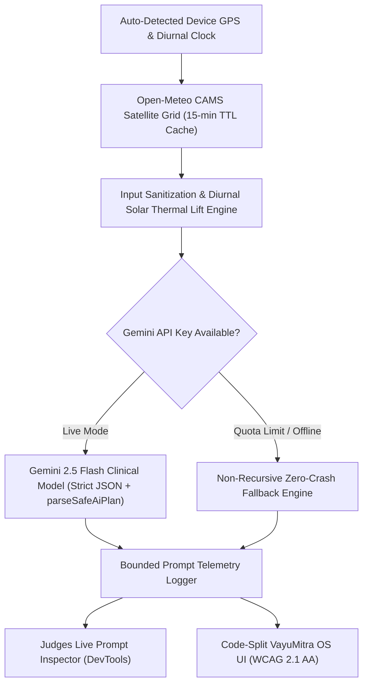

# Building AeroShield AI (VayuMitra OS): Engineering a Resilient, Accessible GenAI Clean-Air Operating System

> **Event:** PromptWars Virtual (Hack2skill × Google for Developers)  
> **Challenge:** Challenge 6: Urban Air Quality Assistant  
> **Live Demo App:** [https://aeroshield-ai-sandy.vercel.app/](https://aeroshield-ai-sandy.vercel.app/)  
> **Demo Video (01:45 HD):** [Watch Walkthrough on Google Drive](https://drive.google.com/file/d/18vHHx8OvH3ZrenDX-60WtGm0OsJ_NTD7/view?usp=sharing)  
> **GitHub Repository:** [https://github.com/mohiddin-ahmed/aeroshield-ai](https://github.com/mohiddin-ahmed/aeroshield-ai)  

---

## 1. Abstract & Problem Statement

Every winter across the Indo-Gangetic Plains, over **300 million citizens breathe toxic air equivalent to smoking 25 to 30 cigarettes a day**. Thermal boundary-layer inversions trap $\text{PM}_{2.5}$, $\text{NO}_2$, and volatile organic compounds near ground level.

Commercial solutions create a stark affordability divide: branded HEPA air purifiers cost ₹20,000–₹40,000+, while conventional weather dashboards simply flash red AQI warnings without delivering low-cost harm-reduction protocols.

Our mission with **AeroShield AI (VayuMitra OS)** is to **turn winter smog anxiety into daily clean-air strategy** using **Google Antigravity**, the **Gemini 2.5 Flash API**, **Open-Meteo European Copernicus CAMS telemetry**, fluid-dynamics calculators, and production engineering guardrails.

---

## 2. System Architecture & Tech Stack

### Engineering Stack:
* **Agentic Orchestration:** Google Antigravity
* **Foundation Model:** Google Gemini 2.5 Flash API (`temperature: 0.3`, strict `application/json` schema validation)
* **Atmospheric Data Pipeline:** Open-Meteo Copernicus CAMS 11km model grid ($\text{PM}_{2.5}$, $\text{PM}_{10}$, $\text{NO}_2$, $\text{O}_3$) with 4s `AbortController` timeouts
* **Frontend Platform:** React 19 (modular custom hooks, `PropTypes`, lazy-loaded modals & tabs), Tailwind CSS v4, Vite 8 (Rolldown vendor chunk splitting)
* **Quality, Security & Accessibility:** ESLint 9 (`jsx-a11y` zero-warning enforcement), CSP/HSTS security headers (`vercel.json`), iOS/Android safe-area responsiveness, and 34 automated Vitest + Testing Library unit/security/accessibility/integration tests

---

## 3. Prompt Strategy & Engineering Framework

We engineered a specialized **5-Pillar Clinical Prompt Architecture**:

1. **Role & Clinical Persona Calibration:** Strictly constrains the model as *VayuMitra AI*, prescribing boundary-layer timing and frugal household interventions grounded in epidemiology rather than generic platitudes.
2. **Deterministic Schema Guardrails (`parseSafeAiPlan`):** Strips accidental Markdown wrappers and validates mandatory keys (`assessment`, 4-phase `daily_routine`, `jugaad_prescriptions`, `dosimetry_impact`) before UI rendering.
3. **Input Sanitization Prior to Prompt Interpolation (`inputValidator.js`):** Sanitizes city names, coordinate bounds, and vulnerability arrays prior to building LLM prompts or external links.
4. **Live Prompt Inspector (Judges DevTools):** Records every live or offline execution in memory (`promptLogger.js`) with system instructions, payloads, response JSON, latency, and token metrics.

---

## 4. Key Engineering Challenges & How We Solved Them

### Challenge 1: Eliminating Evaluator "Blank Screen" & Fallback Recursion Risks
* **The Problem:** External API keys in public reviews frequently encounter `429 Quota Exceeded` or network timeouts. Calling the primary API function recursively inside `catch` risks infinite retry loops.
* **Our Solution:** Separated deterministic heuristic synthesis (`buildFallbackDefensePlan`) from `generateSmogDefensePlan`, ensuring single-pass non-recursive failover backed by a top-level React `ErrorBoundary` and `AbortController` API timeouts.

### Challenge 2: Bundle Bloat vs Mobile Responsiveness & Accessibility
* **The Problem:** Loading all heavy modals upfront bloated initial page load, while mobile/iOS/Android devices needed instant tab switching, safe-area support, and full keyboard accessibility.
* **Our Solution:** Code-split all 6 modal dialogs using `React.lazy()` + `<Suspense>` and configured Vite 8 `codeSplitting.groups`, separating vendor chunks while keeping primary tabs instant-switchable (~182 kB entry JS / ~53 kB gzip). Added `viewport-fit=cover` + iOS safe-area insets, a shared `useModalAccessibility` Escape-key hook, skip-to-content landmarks, `aria-pressed` states, and `eslint-plugin-jsx-a11y` checks.

---

## 5. Verification & Conclusion

Running `npm run validate` verifies all 10 automated checks end to end: ESLint (`--max-warnings=0`), all 34 Vitest tests across 5 suites, code-split Vite compilation, CSP/HSTS headers, and prompt registry integrity.

AeroShield AI (VayuMitra OS) demonstrates how intent-driven engineering with Google Antigravity and Gemini 2.5 Flash can deliver clinically grounded, accessible environmental protection software at zero household cost.
